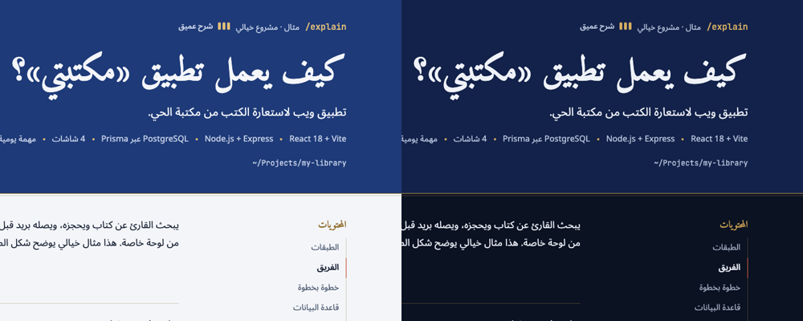
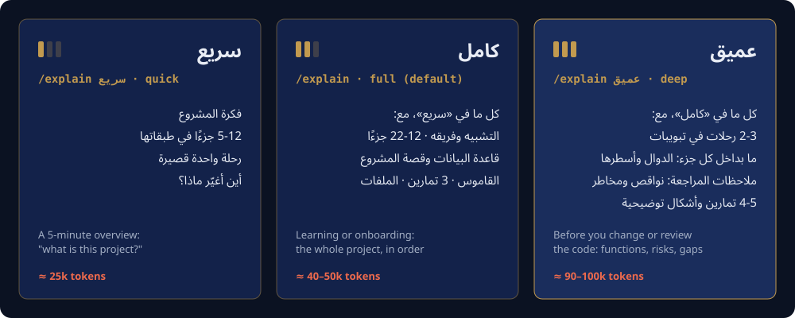
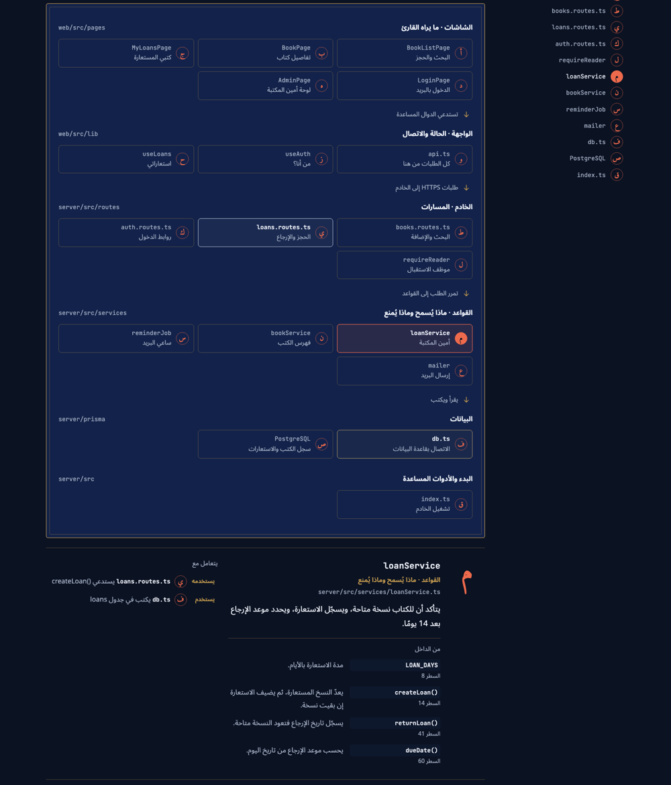
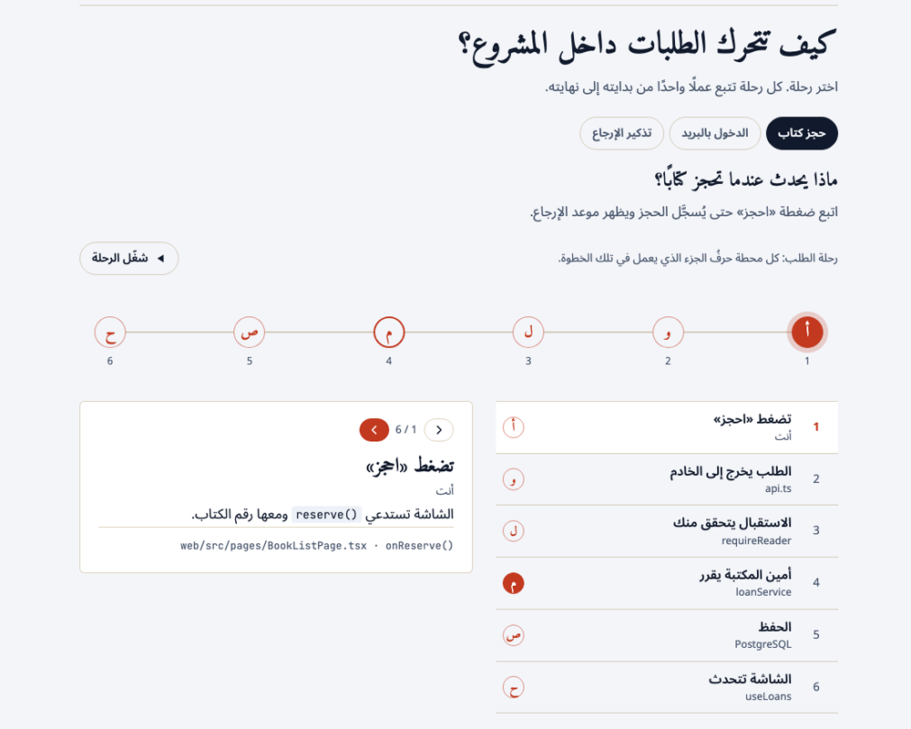
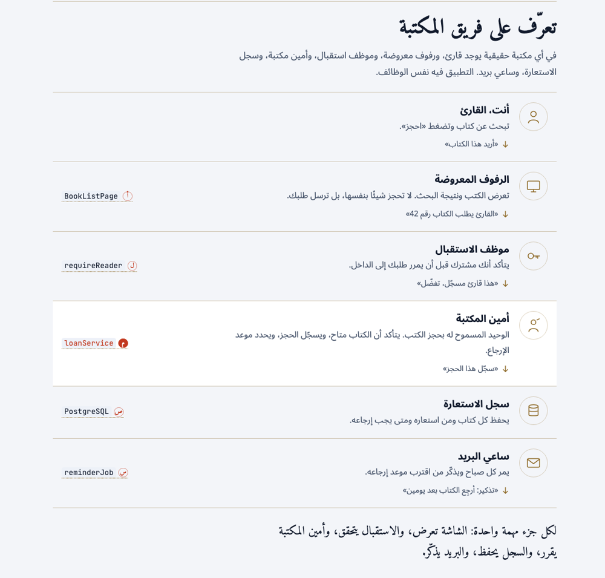
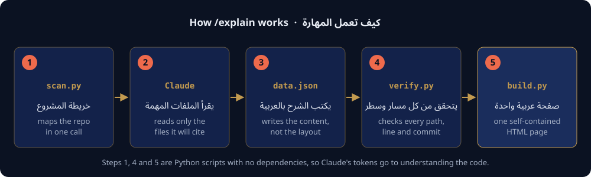

<div dir="rtl">

# /explain · شرح المشاريع بالعربية

**[English below ↓](#english)**

مهارة (Skill) لـ Claude تشرح أي مشروع برمجي شرحًا كاملًا بالعربية، في صفحة تفاعلية واحدة من اليمين إلى اليسار. المطور المبتدئ يفهم منها المشروع، والمطور الخبير يستخدمها خريطةً بجانب الكود.

افتح أي مشروع في Claude Code واكتب:

> /explain



استلمت مشروعًا لا تعرف من أين تبدأ فيه؟ أو كتبته مع الذكاء الاصطناعي ولا تفهم كيف يعمل؟ يقرأ Claude الكود الحقيقي، ثم يكتب لك صفحة تشرح ما هو المشروع، ومم يتكوّن، وكيف يتحرك الطلب داخله، وأين تغيّر ما تريد. كل مسار ورقم سطر في الصفحة يُفحص على المشروع قبل أن تصلك.

## المحتويات

- [البدء السريع](#البدء-السريع)
- [ثلاثة أعماق للشرح](#ثلاثة-أعماق-للشرح)
- [ماذا تجد في الصفحة](#ماذا-تجد-في-الصفحة)
- [أمثلة على الطلبات](#أمثلة-على-الطلبات)
- [جرّبها بدون مشروع](#جرّبها-بدون-مشروع)
- [كيف تعمل](#كيف-تعمل)
- [التكلفة](#التكلفة)
- [الخصوصية](#الخصوصية)

## البدء السريع

**1. ثبّت المهارة.** لكل مشاريعك:

</div>

```bash
git clone https://github.com/AmrSabbagh35/project-explainer-ar.git ~/.claude/skills/explain
```

<div dir="rtl">

أو لمشروع واحد فقط، حتى يستخدمها كل الفريق:

</div>

```bash
git clone https://github.com/AmrSabbagh35/project-explainer-ar.git .claude/skills/explain
```

<div dir="rtl">

**2. أعد تشغيل Claude Code**، ثم افتح المشروع الذي تريد فهمه.

**3. اكتب `/explain`.** بعد دقائق تصلك صفحة الشرح: رابطًا إذا كانت أداة Artifacts متاحة، أو ملف HTML تفتحه في المتصفح.

تحتاج فقط Python 3، بدون أي مكتبات إضافية، ولا أي اشتراك أو خدمة صور مدفوعة. كل الأشكال يرسمها Claude بنفسه بصيغة SVG.

## ثلاثة أعماق للشرح



| الأمر | متى تستخدمه | ماذا تحتوي الصفحة |
| --- | --- | --- |
| `/explain سريع` | تريد أن تعرف ما هذا المشروع في 5 دقائق | فكرة المشروع، وطبقاته وأهم 5–12 جزءًا فيه، ورحلة واحدة قصيرة، و«أين أغيّر ماذا؟». |
| `/explain` أو `/explain كامل` | تتعلّم المشروع أو تستلمه | كل ما سبق، مع التشبيه وفريقه، و12–22 جزءًا، وقاعدة البيانات، وقصة المشروع من git، والقاموس، و3 تمارين، وشجرة الملفات. |
| `/explain عميق` | ستعدّل الكود أو تراجعه | كل ما سبق، مع رحلتين أو ثلاث في تبويبات، وما بداخل كل جزء مهم (الدوال وأرقام أسطرها)، و«ملاحظات المراجعة»، و4–5 تمارين. |

كلمات أخرى تعمل أيضًا: «مختصر» و«نظرة سريعة» للسريع، و«مفصل» و«تفصيلي» و«للمراجعة» للعميق. ويمكنك كتابتها بالإنجليزية: `quick` و `full` و `deep`. يظهر عمق الشرح في رأس الصفحة بثلاثة أعمدة صغيرة، وتنتهي الصفحة السريعة والكاملة بسطر يدلّك على العمق التالي.

## ماذا تجد في الصفحة

الصور التالية من صفحة عميقة لمشروع مثال خيالي (تطبيق «مكتبتي» لاستعارة الكتب)، موجود في مجلد `examples/`.

### خريطة الطبقات

كل جزء من المشروع في طبقته، من الشاشة حتى قاعدة البيانات، ولكل جزء حرف من حروف أبجد يتبعه في كل الصفحة. اضغط على أي جزء فترى ماذا يفعل، وأين ملفه، ومن يستخدمه ومن يستخدم هو. في الشرح العميق تظهر أيضًا الدوال المهمة داخله وأرقام أسطرها.



### رحلة الطلب خطوة بخطوة

اتبع عملًا واحدًا، مثل «احجز كتابًا»، من الضغطة حتى الحفظ. كل محطة تحمل حرف الجزء الذي يعمل فيها، وزر «شغّل الرحلة» يمرّ عليها وحده. في الشرح العميق تجد رحلتين أو ثلاثًا في تبويبات.



### تشبيه من عالم المشروع نفسه

مستشفى لتطبيق طبي، وحكم ولوحة نتائج لتطبيق رياضي، وأمين مكتبة لتطبيق مكتبة. كل دور في التشبيه مربوط بالكلاس الذي يؤديه في الكود.



### ملاحظات المراجعة (في الشرح العميق)

ما لاحظه Claude أثناء القراءة: أشياء ناقصة، ومخاطر، ومشاكل أمان، وديون تقنية، وبطء. كل ملاحظة تشير إلى ملفها وسطرها، ولا تُكتب إلا إذا كان الكود يثبتها.


### وأيضًا

- **خريطة قاعدة البيانات:** الجداول وأعمدتها، والعلاقات بجمل عربية بسيطة مثل «كل استعارة تخص قارئًا واحدًا».
- **قصة المشروع من `git log`:** اللحظات التي تشرح لماذا الكود مكتوب بهذه الطريقة اليوم.
- **الشاشات أو المسارات أو الأوامر**، حسب نوع المشروع.
- **قاموس** للكلمات التي ستراها في الكود، وجدول **«أين أغيّر ماذا؟»**.
- **تمارين** بأرقام أسطر حقيقية، مع الإجابات.
- **أشكال توضيحية** يرسمها Claude عند الحاجة: أين يعمل كل جزء، أو مسار أمان، أو حالات الطلب.
- **مفتاح مبتدئ / خبير:** وضع المبتدئ يخفي المسارات والتفاصيل التقنية ويبقي الشرح.
- تعمل بالوضع الفاتح والداكن وعلى الهاتف، وتتذكر آخر جزء اخترته.

## أمثلة على الطلبات

| ما تكتبه | ما يحدث |
| --- | --- |
| `/explain` | شرح كامل للمشروع المفتوح. |
| `/explain سريع` | نظرة سريعة على المشروع المفتوح. |
| `/explain ~/Projects/shop` | شرح كامل لمشروع آخر. |
| `/explain عميق ~/Projects/shop` | شرح عميق مع ملاحظات المراجعة. |
| `/explain مسار الدفع` | شرح كامل تركّز رحلته على الدفع. |
| «استلمت هذا المشروع ولا أفهم كيف يعمل، ارسم لي مكوناته» | تعمل المهارة تلقائيًا، بدون `/explain`. |
| «أريد شرحًا مختصرًا للمشروع للطلاب الجدد» | شرح سريع. |
| «Explain this repo in Arabic for my team» | شرح كامل بالعربية. |

## جرّبها بدون مشروع

في مجلد `examples/` ثلاثة ملفات بيانات لنفس المشروع الخيالي، واحد لكل عمق. ابنِ أي منها وافتحه:

</div>

```bash
cd ~/.claude/skills/explain
python3 -I scripts/build.py examples/sample-quick.json /tmp/explain-quick.html
python3 -I scripts/build.py examples/sample.json /tmp/explain-full.html
python3 -I scripts/build.py examples/sample-deep.json /tmp/explain-deep.html
open /tmp/explain-deep.html   # على Linux: xdg-open
```

<div dir="rtl">

## كيف تعمل



يكتب Claude المحتوى فقط، أما شكل الصفحة فقالب ثابت. لذلك تبدو كل الصفحات متناسقة، ويذهب جهد Claude إلى فهم الكود وكتابة عربية واضحة.

| الملف | الوظيفة |
| --- | --- |
| `SKILL.md` | التعليمات لـ Claude: ماذا يقرأ، وكيف يختار العمق والتشبيه، وكيف يكتب العربية. |
| `scripts/scan.py` | خريطة المشروع في أمر واحد: المجلدات، والمكتبات، ونقاط البداية، وأكبر الملفات وما تعرّفه، والمسارات، وقاعدة البيانات، وتاريخ git. |
| `scripts/verify.py` | يتحقق في أمر واحد من كل مسار ورقم سطر ودالة و commit مذكور في الصفحة. |
| `scripts/build.py` | يدمج البيانات في القالب، وينظّف الأشكال، ويرفض الأخطاء مثل الروابط المكسورة. |
| `assets/template.html` | قالب الصفحة. |
| `references/data.md` | شكل ملف البيانات وأحجام كل عمق. |
| `references/figures.md` | قواعد رسم الأشكال التوضيحية. |
| `examples/` | المشروع الخيالي بالأعماق الثلاثة. |

## التكلفة

كلما زاد العمق قرأ Claude ملفات أكثر. هذه أرقام قِسناها على مشاريع حقيقية، بعد طرح التكلفة الثابتة لأي جلسة Claude Code:

| العمق | مشروع صغير (25 ملفًا) | مشروع كبير (1,854 ملفًا) |
| --- | --- | --- |
| سريع | نحو 25 ألف رمز (token) | — |
| كامل | نحو 38 ألفًا | نحو 48 ألفًا |
| عميق | — | نحو 93 ألفًا، مع مساعدين صغيرين على نموذج Haiku |

في المشاريع الكبيرة يرسل Claude مساعدًا على نموذج Haiku الأرخص ليتتبع رحلة واحدة، بدل أن يقرأ المشروع كله بنفسه.

## الخصوصية

المهارة تقرأ الكود على جهازك فقط. الصفحة الناتجة تحتوي أسماء الملفات وشكل المجلدات ورسائل الـ commits، وفي الشرح العميق ملاحظات عن نقاط الضعف. راجعها قبل نشرها إذا كان المشروع خاصًا.

## المساهمة

الاقتراحات والتحسينات مرحّب بها عبر Issues و Pull Requests، خصوصًا تحسين صياغة العربية وإضافة تشبيهات لأنواع جديدة من المشاريع.

## الرخصة

MIT

</div>

---

<a id="english"></a>

# /explain · Explain any codebase in Arabic

**/explain** is a Claude skill that explains any software project in full, plain Arabic, as one interactive right-to-left HTML page. Beginners use it to understand a project they inherited or vibe-coded; experienced developers keep it open beside the code as a map.

Open a project in Claude Code and type:

> /explain


Claude reads the real code, then writes a page that says what the project is, what it's made of, how a request travels through it, and where to change things. Every path and line number on the page is checked against the repository before you see it.

## Contents

- [Quick start](#quick-start)
- [Three depths](#three-depths)
- [What's on the page](#whats-on-the-page)
- [Example requests](#example-requests)
- [Try it without a project](#try-it-without-a-project)
- [How it works](#how-it-works)
- [Cost](#cost)
- [Privacy](#privacy)

## Quick start

**1. Install the skill.** For all your projects:

```bash
git clone https://github.com/AmrSabbagh35/project-explainer-ar.git ~/.claude/skills/explain
```

Or for one project, so the whole team gets it:

```bash
git clone https://github.com/AmrSabbagh35/project-explainer-ar.git .claude/skills/explain
```

**2. Restart Claude Code** and open the project you want explained.

**3. Type `/explain`.** A few minutes later you get the page, as a link if the Artifacts tool is available, or as an HTML file to open in your browser.

It needs Python 3 and nothing else: no extra packages, no subscriptions and no paid image service. Claude draws every figure itself as SVG.

## Three depths


| Command | Use it when | The page has |
| --- | --- | --- |
| `/explain quick` (or `سريع`) | you want to know what the project is in 5 minutes | the idea, its layers with the 5–12 parts that matter, one short flow, and "where do I change what". |
| `/explain` (or `full`, `كامل`) | you're learning or taking over the project | all of the above, plus the analogy cast, 12–22 parts, the database, the project's story from git, a glossary, 3 exercises and the file tree. |
| `/explain deep` (or `عميق`) | you're about to change or review the code | all of the above, plus 2–3 flows as tabs, the key functions inside each central part with line numbers, review notes, and 4–5 exercises. |

The page header shows its depth as a three-bar gauge, and quick and full pages end with a line pointing to the next depth.

## What's on the page

The screenshots below come from a deep page for a fictional sample project, a library-lending app called «مكتبتي», which ships in `examples/`.

### The layer map

Every part of the project in its layer, from screens down to the database. Each part gets an Arabic abjad letter that follows it across the whole page. Click a part to see what it does, where its file is, and what it uses and is used by. Deep pages also list the functions inside it with their line numbers.


### A request, step by step

Follow one action, like "reserve a book", from the tap to the database. Each station carries the letter of the part doing the work, and the play button walks through them. Deep pages put 2–3 flows in tabs.


### An analogy from the project's own world

A hospital for a medical app, an umpire and scoreboard for a sports app, a librarian for a library app. Each role is tied to the class that plays it in the code.


### Review notes (deep)

What Claude noticed while reading: gaps, risks, security issues, tech debt and slow spots. Each note cites its file and line, and only what the code shows gets written down.


### Also on the page

- **A database map:** tables, columns, and relations in plain Arabic sentences.
- **The project's story from `git log`:** the moments that explain why the code looks the way it does today.
- **Screens, routes or commands**, depending on the kind of project.
- **A glossary** of words you'll meet in the code, and a **"where do I change what"** table.
- **Exercises** with real line numbers, and answers.
- **Figures** Claude draws when they help: where things run, a safety pipeline, a state machine.
- **A beginner / expert switch:** beginner mode hides paths and technical detail and keeps the explanations.
- Light and dark themes, phone layout, and it remembers the last part you selected.

## Example requests

| You type | What happens |
| --- | --- |
| `/explain` | A full page for the open project. |
| `/explain quick` | A quick overview of the open project. |
| `/explain ~/Projects/shop` | A full page for another project. |
| `/explain deep ~/Projects/shop` | A deep page with review notes. |
| `/explain the payment flow` | A full page whose flow follows payments. |
| "Explain this repo in Arabic for my team" | The skill triggers on its own, no `/explain` needed. |

## Try it without a project

`examples/` holds the same fictional project at all three depths. Build one and open it:

```bash
cd ~/.claude/skills/explain
python3 -I scripts/build.py examples/sample-quick.json /tmp/explain-quick.html
python3 -I scripts/build.py examples/sample.json /tmp/explain-full.html
python3 -I scripts/build.py examples/sample-deep.json /tmp/explain-deep.html
open /tmp/explain-deep.html   # on Linux: xdg-open
```

## How it works


Claude writes only the content; the layout is a fixed template. That keeps every page consistent and puts Claude's effort into understanding the code and writing clear Arabic.

| File | Job |
| --- | --- |
| `SKILL.md` | Instructions for Claude: what to read, how to pick the depth and the analogy, how to write the Arabic. |
| `scripts/scan.py` | Maps the repo in one call: folders, dependencies, entry points, the biggest files and what they declare, routes, database schema and git history. |
| `scripts/verify.py` | Checks every path, line number, function and commit the page cites, in one call. |
| `scripts/build.py` | Merges the data into the template, sanitizes figures, and rejects mistakes like broken links. |
| `assets/template.html` | The page template. |
| `references/data.md` | The data file's shape and each depth's sizes. |
| `references/figures.md` | Rules for drawing figures. |
| `examples/` | The fictional project at all three depths. |

## Cost

Deeper pages read more code. Measured on real projects, after subtracting the fixed cost every Claude Code session carries:

| Depth | Small project (25 files) | Large project (1,854 files) |
| --- | --- | --- |
| quick | about 25k tokens | — |
| full | about 38k | about 48k |
| deep | — | about 93k, plus small Haiku helpers |

On large projects Claude sends a helper on the cheaper Haiku model to trace one flow, instead of reading the whole project itself.

## Privacy

The skill reads code on your machine only. The page it produces contains your file names, folder layout and commit messages, and deep pages describe weak spots. Review it before you share it if the project is private.

## Contributing

Issues and pull requests are welcome, especially improvements to the Arabic wording and analogies for new kinds of projects.

## License

MIT
